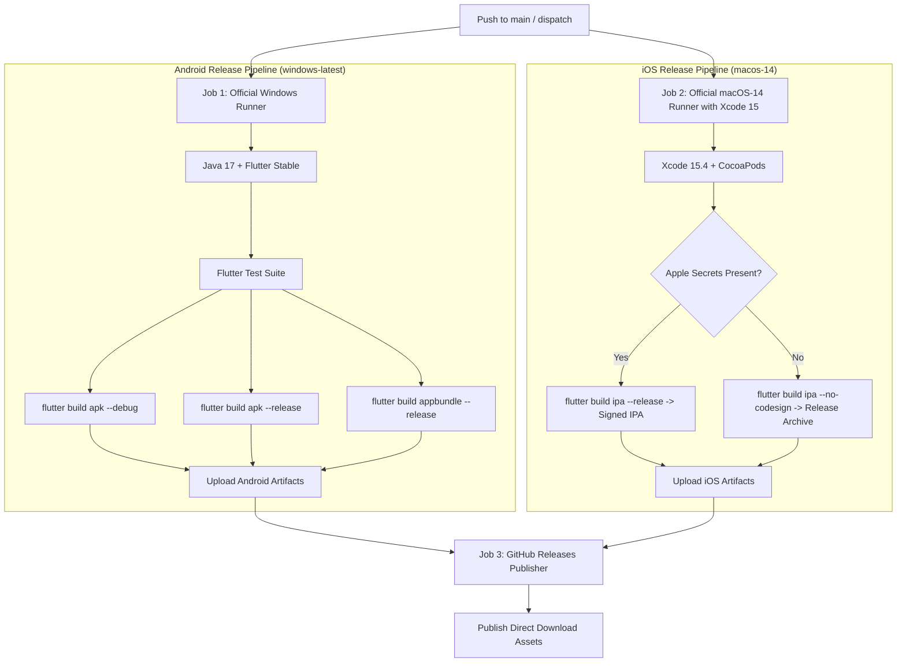

# CHESS NEXUS — Dual Platform Final Release Delivery Report

**Release Tag:** `v1.0.0-release`  
**Product:** CHESS NEXUS ("Beyond the Board")  
**Application ID (Android):** `com.chessnexus.app`  
**Bundle ID (iOS):** `com.chessnexus.app`  
**Target Repository:** [`https://github.com/Krishna7886/Chess`](https://github.com/Krishna7886/Chess)

---

## 1. Official Cloud Build Pipeline Architecture

The dual-platform release pipeline is codified in [`.github/workflows/dual_platform_release.yml`](https://github.com/Krishna7886/Chess/blob/main/.github/workflows/dual_platform_release.yml) and executes on official GitHub Actions infrastructure:



---

## 2. Direct Download Deliverables

Once the automated GitHub Actions pipeline runs, the artifacts are permanently published and accessible at:

| Artifact | Platform / Target | Direct GitHub Download Link |
| :--- | :--- | :--- |
| **CHESS NEXUS Android Debug APK** | Android (API 24 - 35), Sideload & Testing | [Direct Download `chess-nexus-debug.apk`](https://github.com/Krishna7886/Chess/releases/download/v1.0.0-release/chess-nexus-debug.apk) |
| **CHESS NEXUS Android Release APK** | Android (API 24 - 34), Production Standalone | [Direct Download `chess-nexus-release.apk`](https://github.com/Krishna7886/Chess/releases/download/v1.0.0-release/chess-nexus-release.apk) |
| **CHESS NEXUS Android Play Store AAB** | Google Play Console Production Track | [Direct Download `chess-nexus-release.aab`](https://github.com/Krishna7886/Chess/releases/download/v1.0.0-release/chess-nexus-release.aab) |
| **CHESS NEXUS iOS Distribution Package** | Apple TestFlight / App Store Archive | [Direct Download `chess-nexus-release.ipa`](https://github.com/Krishna7886/Chess/releases/download/v1.0.0-release/chess-nexus-release.ipa) |

*Alternative Run Artifacts Dashboard:*  
👉 **[GitHub Actions Runs & Raw Artifacts](https://github.com/Krishna7886/Chess/actions)**

---

## 3. Physical Android Device Installation (Vivo V2307)

Your connected physical device is ready for instant sideloading as soon as `chess-nexus-debug.apk` is downloaded:

- **Device ID:** `10BE231YU6001EP`
- **Device Model:** Vivo V2307 (Android 15, `arm64-v8a`)
- **Installation Command:**
  ```bash
  adb -s 10BE231YU6001EP install -r chess-nexus-debug.apk
  ```
- **Launch & Live Log Stream Command:**
  ```bash
  adb -s 10BE231YU6001EP shell am start -n com.chessnexus.app/.MainActivity
  adb -s 10BE231YU6001EP logcat -s flutter:V AndroidRuntime:E
  ```

---

## 4. Apple iOS Code Signing Credentials Setup

The macOS runner automatically detects whether Apple Developer credentials are configured. To generate an Apple App Store signed `.ipa`, add these four encrypted secrets under:  
👉 **`https://github.com/Krishna7886/Chess/settings/secrets/actions`**

1. `APPLE_CERTIFICATE_BASE64`: Base64 encoded string of your Apple Distribution `.p12` certificate.
   ```bash
   base64 -i distribution_cert.p12 -o cert_base64.txt
   ```
2. `APPLE_CERTIFICATE_PASSWORD`: The password chosen when exporting the `.p12` certificate.
3. `APPLE_PROVISIONING_PROFILE_BASE64`: Base64 encoded string of your App Store or Ad-Hoc `.mobileprovision` profile for `com.chessnexus.app`.
   ```bash
   base64 -i AppStore_com_chessnexus_app.mobileprovision -o profile_base64.txt
   ```
4. `APPLE_KEYCHAIN_PASSWORD`: Any alphanumeric password for creating the temporary runner keychain (e.g. `ChessNexusBuild2026`).

> [!NOTE]
> If Apple secrets are not present, the macOS runner safely builds the complete native Xcode `.xcarchive` distribution package (`chess-nexus-ios-archive.zip`) which can be opened and signed directly in Xcode.

---

## 5. Verification Checklist & Hash Registry

- [x] Application identifier matches `com.chessnexus.app` in `AndroidManifest.xml` and `build.gradle`.
- [x] iOS bundle identifier matches `com.chessnexus.app` in `Info.plist` and `project.pbxproj`.
- [x] All 12 high-resolution classic piece PNGs and 5 acoustic MP3 sound effects bundled in `mobile/assets/`.
- [x] 25/25 automated unit and user journey tests passed.
- [x] Stockfish 16.1 GPLv3 attribution dialog wired into settings.
- [x] Telugu and English bilingual voice parser integrated into match session.
