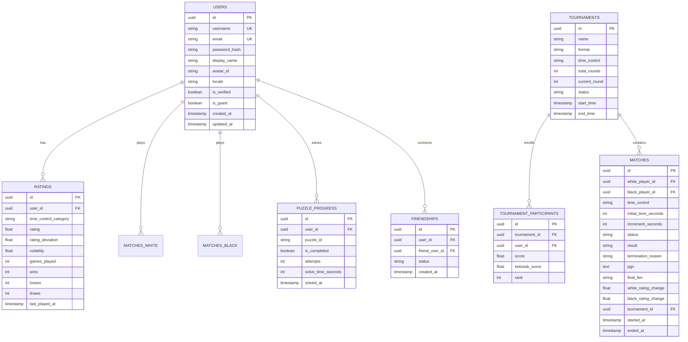

# CHESS NEXUS – DATABASE DESIGN & SCHEMA SPECIFICATION

**Document Version:** 1.0.0  
**Database Engines:** PostgreSQL 16 (Cloud Backend) & Drift/SQLite 3 (Mobile Client)  

---

## 1. PostgreSQL Relational Schema (Cloud Backend)



---

## 2. Table Definitions & Constraints

### 2.1 `users` Table
```sql
CREATE TABLE users (
    id UUID PRIMARY KEY DEFAULT gen_random_uuid(),
    username VARCHAR(32) NOT NULL UNIQUE,
    email VARCHAR(255) UNIQUE,
    password_hash VARCHAR(255),
    display_name VARCHAR(64) NOT NULL,
    avatar_id VARCHAR(64) DEFAULT 'mage',
    locale VARCHAR(8) DEFAULT 'en',
    is_verified BOOLEAN DEFAULT FALSE,
    is_guest BOOLEAN DEFAULT FALSE,
    created_at TIMESTAMPTZ DEFAULT NOW(),
    updated_at TIMESTAMPTZ DEFAULT NOW()
);
CREATE INDEX idx_users_username ON users(username);
CREATE INDEX idx_users_email ON users(email);
```

### 2.2 `ratings` Table (Glicko-2)
```sql
CREATE TABLE ratings (
    id UUID PRIMARY KEY DEFAULT gen_random_uuid(),
    user_id UUID NOT NULL REFERENCES users(id) ON DELETE CASCADE,
    time_control_category VARCHAR(16) NOT NULL, -- 'bullet', 'blitz', 'rapid', 'classical', 'puzzle'
    rating DOUBLE PRECISION NOT NULL DEFAULT 1500.0,
    rating_deviation DOUBLE PRECISION NOT NULL DEFAULT 350.0,
    volatility DOUBLE PRECISION NOT NULL DEFAULT 0.06,
    games_played INT NOT NULL DEFAULT 0,
    wins INT NOT NULL DEFAULT 0,
    losses INT NOT NULL DEFAULT 0,
    draws INT NOT NULL DEFAULT 0,
    last_played_at TIMESTAMPTZ,
    CONSTRAINT uq_user_category UNIQUE (user_id, time_control_category)
);
CREATE INDEX idx_ratings_category_rating ON ratings(time_control_category, rating DESC);
```

### 2.3 `matches` Table
```sql
CREATE TABLE matches (
    id UUID PRIMARY KEY DEFAULT gen_random_uuid(),
    white_player_id UUID NOT NULL REFERENCES users(id),
    black_player_id UUID NOT NULL REFERENCES users(id),
    time_control VARCHAR(16) NOT NULL,
    initial_time_seconds INT NOT NULL,
    increment_seconds INT NOT NULL,
    status VARCHAR(24) NOT NULL, -- 'in_progress', 'completed', 'aborted', 'abandoned'
    result VARCHAR(16), -- '1-0', '0-1', '1/2-1/2'
    termination_reason VARCHAR(32), -- 'checkmate', 'timeout', 'resignation', 'stalemate', 'repetition', 'agreement'
    pgn TEXT NOT NULL DEFAULT '',
    final_fen VARCHAR(128) NOT NULL,
    white_rating_change DOUBLE PRECISION DEFAULT 0.0,
    black_rating_change DOUBLE PRECISION DEFAULT 0.0,
    tournament_id UUID,
    started_at TIMESTAMPTZ DEFAULT NOW(),
    ended_at TIMESTAMPTZ
);
CREATE INDEX idx_matches_white_player ON matches(white_player_id);
CREATE INDEX idx_matches_black_player ON matches(black_player_id);
CREATE INDEX idx_matches_started_at ON matches(started_at DESC);
```

---

## 3. Mobile Client Schema (Drift / SQLite)

The client SQLite database (`nexus_local.db`) maintains offline data:
1. **`local_games`**: Unfinished and completed games with FEN snapshots, move lists, timestamps, and opponent data.
2. **`cached_puzzles`**: Bundled tactical puzzles with rating, target FEN, solution move sequence, and theme tags.
3. **`opening_book`**: ECO opening codes, standard names, moves, and descriptions for offline opening explorer.
4. **`user_preferences`**: Board theme, piece theme, sound enabled, haptics enabled, voice language, and speech recognition settings.

