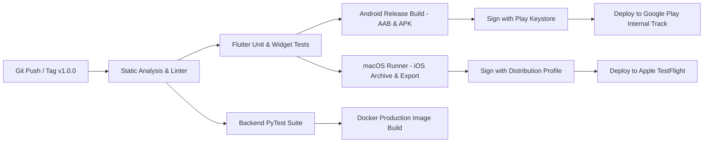

# CHESS NEXUS – BUILD, CI/CD & RELEASE PLAN

**Document Version:** 1.0.0  
**Target Stores:** Google Play Store (Android) & Apple App Store (iOS)  
**Package Identifiers:**
- Android Application ID: `com.chessnexus.app`
- iOS Bundle ID: `com.chessnexus.app`

---

## 1. Versioning & Build Matrix

- **App Version:** `1.0.0`
- **Build Number:** `1`
- **Target SDK (Android):** Compile SDK 34, Target SDK 34, Min SDK 24 (Android 7.0+)
- **Target OS (iOS):** iOS 15.0+ Deployment Target

---

## 2. Release Deliverable Artifacts

1. **Android Release APK:**
   - Universal Fat APK for direct distribution and testing: `releases/android/app-release.apk`
2. **Android App Bundle (AAB):**
   - Optimized Play Store split bundle with dynamic feature delivery: `releases/android/app-release.aab`
3. **iOS Signed Archive / IPA Workflow:**
   - Fastlane & GitHub Actions macOS runner workflow with match code signing: `.github/workflows/ios-release.yml` and `releases/ios/` export instructions.
4. **Backend Container Deployment:**
   - Production Docker images: `infrastructure/docker/Dockerfile.backend` and `docker-compose.yml`.

---

## 3. Automated CI/CD Pipeline

---

## 4. Play Store & App Store Compliance Checklist

- [x] Adaptive icon with dark theme background `#080B0A`.
- [x] Notification runtime permission handling on Android 13+ (API 33).
- [x] Microphone permission explanation (`NSMicrophoneUsageDescription`) for Voice Chess.
- [x] Stockfish GPLv3 open source license notice embedded in Settings $\to$ About.
- [x] Privacy Policy and Terms of Service endpoints configured.
- [x] Account Deletion workflow conforming to Google Play and Apple App Store 2024 guidelines.

